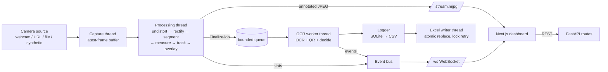

# 02 — Tech Stack & Directory Architecture

Speed and reliability over architectural perfection. Everything runs on **one laptop, offline**, in **two processes**: the backend (`:8000`, API + vision pipeline threads) and the web dashboard (`:3000`).

---

## 1. Tech stack (exact choices — do not substitute)

### Backend (Python)

| Concern | Choice | Notes |
|---|---|---|
| Language | **Python 3.11** | Type hints everywhere |
| Vision | **opencv-python** `>=4.8` | ArUco is in the main package since 4.7 (`cv2.aruco.ArucoDetector`); QR via `cv2.QRCodeDetector`; **never install opencv-contrib or a second OpenCV wheel** |
| Numerics | **numpy** `>=1.26` | |
| OCR | **rapidocr** `>=3.0` + **onnxruntime** `>=1.17` (CPU) | Models download on first run → `make setup` downloads them while online (`rapidocr download_models` or a warm-up call). Wrap behind `vision/ocr.py` |
| Web framework | **FastAPI** `>=0.110` + **uvicorn[standard]** `>=0.29` | Serves REST, WebSocket and MJPEG |
| Contracts | **pydantic** `>=2.6` | |
| Database | **SQLite** via **SQLAlchemy** `>=2.0` Core | File `backend/data/billetvision.db` |
| Excel | **openpyxl** `>=3.1` | Workbook generation only |
| Data | **pandas** `>=2.1` | Exports and evaluation only — not in the per-frame loop |
| Config | **python-dotenv** `>=1.0` | Root `.env` |
| Tests | **pytest** `>=8.0` | Vision tests run on synthetic images — no camera needed |
| WS probe | **websockets** `>=12` | `scripts/ws_probe.py` only |
| Lint | **ruff** `>=0.4` | |
| Optional TTS | ElevenLabs REST via **httpx** `>=0.27` | Off by default (T41) |

### Frontend (TypeScript)

| Concern | Choice |
|---|---|
| Runtime | Node.js 20 LTS+ |
| Framework | Next.js (latest, App Router) via `npx create-next-app@latest web --ts --tailwind --eslint --app --src-dir=false --import-alias "@/*" --use-npm` |
| Styling | Tailwind CSS (version from create-next-app) |
| Components | shadcn/ui — add only: `button card badge table select tabs input textarea separator tooltip sonner skeleton dialog switch label` |
| Charts | recharts |
| Icons | lucide-react |
| Theme | next-themes |
| Data | native `fetch` via `lib/api.ts`; native `WebSocket` via `lib/live.tsx` |
| Live video | `` (MJPEG) |
| Voice alerts | Browser **Web Speech API** (`speechSynthesis`) — free, offline. ElevenLabs optional |

### Explicitly NOT used

YOLO/Ultralytics, PyTorch/TensorFlow, EasyOCR, PaddlePaddle, Tesseract, opencv-contrib, pyzbar, Streamlit, Docker, Redis/Celery, auth libraries, Prisma, socket.io, Redux/Zustand/React Query, CSS-in-JS.

---

## 2. Runtime architecture



### Threads (all started in the FastAPI lifespan, stopped cleanly on shutdown)

| Thread | Does | Never does |
|---|---|---|
| **capture** | Reads frames from the source into a single-slot `LatestFrame` (overwrites; keeps frame index + timestamp); reconnects on failure | Any processing |
| **processing** | Takes the newest frame, runs the per-frame pipeline (SPEC §9–§12), updates tracks, renders the overlay JPEG into `LatestJpeg`, emits `FinalizeJob`s and stats | OCR, disk writes, DB |
| **ocr-worker** | Consumes `FinalizeJob`s (bounded queue size 8; drop oldest with a System alert if full): OCR, QR, ID resolution, decision, snapshot write, DB + CSV log, emits events | Frame processing |
| **excel-writer** | Debounced (2 s) regeneration of `logs/inspections.xlsx` via temp file + `os.replace`; retries every 5 s while locked | Anything else |

Events from threads reach the asyncio loop via `loop.call_soon_threadsafe(queue.put_nowait, event)`; one async task broadcasts to WebSocket clients. Pipeline state shared with routes is guarded by `threading.Lock` objects owned by `runtime/state.py`.

### Purity boundary (strict)

| Pure (no I/O, no threads, no clock, no globals) | Side-effecting |
|---|---|
| everything in `vision/` **except** `ocr.py` (loads a model) | `runtime/*`, `api/*`, `db.py`, `repository.py`, `logging_io.py`, `tools/*` |
| `vision/synth.py` (seeded generator) | |

---

## 3. Complete directory tree (create exactly this)

```
billetvision/
├── GEMINI.md
├── README.md
├── Makefile
├── .env.example
├── .gitignore
├── docs/
│   ├── 01_PRD.md
│   ├── 02_TECH_STACK_AND_ARCHITECTURE.md
│   ├── 03_DATABASE_SCHEMA_AND_CONTRACTS.md
│   ├── 05_IMPLEMENTATION_ROADMAP.md
│   ├── SPEC.md
│   ├── decisions.md
│   ├── assumptions.md
│   ├── limitations.md
│   ├── hardware_setup.md
│   └── demo_runbook.md
├── data/
│   ├── props.csv                      # ground truth for real props (human fills)
│   ├── videos/                        # recorded demo videos (git-ignored)
│   └── calib/                         # checkerboard images (optional, git-ignored)
├── scripts/
│   └── ws_probe.py
├── print/                             # generated marker, labels, checkerboard (git-ignored)
├── backend/
│   ├── requirements.txt
│   ├── pyproject.toml
│   ├── data/                          # billetvision.db (git-ignored)
│   ├── calibration/                   # calibration.json, background.png, intrinsics.json (git-ignored)
│   ├── logs/                          # inspections.csv, inspections.xlsx (git-ignored)
│   ├── snapshots/                     # per-inspection JPEGs (git-ignored)
│   ├── reports/                       # bench_synthetic.json, eval_real.json (git-ignored)
│   ├── billetvision/
│   │   ├── __init__.py
│   │   ├── config.py
│   │   ├── enums.py
│   │   ├── schemas.py
│   │   ├── db.py
│   │   ├── repository.py
│   │   ├── logging_io.py              # CSV append + Excel writer + exports builders
│   │   ├── evaluation.py              # real-props accuracy maths (pure)
│   │   ├── vision/
│   │   │   ├── __init__.py
│   │   │   ├── types.py               # dataclasses: Detection, Measurement, Track, FinalizeJob, Calibration
│   │   │   ├── synth.py               # synthetic scenes + videos with ground truth
│   │   │   ├── calibration.py         # ArUco homography, intrinsics, drift check
│   │   │   ├── rectify.py             # undistort + warp to bed (mm) space
│   │   │   ├── segment.py             # background difference + threshold + contours
│   │   │   ├── measure.py             # sub-pixel profile measurement
│   │   │   ├── defects.py             # cross-section variation, taper, camber, notch, bulge
│   │   │   ├── track.py               # centroid tracker + triggers + aggregation
│   │   │   ├── idparse.py             # template normalise, confusion fixes, voting
│   │   │   ├── ocr.py                 # RapidOCR adapter (only impure vision module)
│   │   │   ├── qr.py
│   │   │   ├── decide.py              # Pass/Rework/Fail + reasons
│   │   │   └── overlay.py             # draw annotations
│   │   ├── runtime/
│   │   │   ├── __init__.py
│   │   │   ├── sources.py             # webcam / url / file / synthetic + capture thread
│   │   │   ├── state.py               # shared state + locks + LatestFrame/LatestJpeg
│   │   │   ├── pipeline.py            # processing thread
│   │   │   ├── worker.py              # OCR worker thread
│   │   │   ├── events.py              # event bus (thread → asyncio)
│   │   │   └── metrics.py             # FPS, latency ring buffers
│   │   ├── api/
│   │   │   ├── __init__.py
│   │   │   ├── main.py
│   │   │   ├── ws.py
│   │   │   ├── deps.py
│   │   │   ├── errors.py
│   │   │   └── routes/
│   │   │       ├── __init__.py
│   │   │       ├── stream.py          # /stream.mjpg, /snapshot.jpg
│   │   │       ├── status.py          # /health, /status, /metrics
│   │   │       ├── control.py         # /source, /control/*
│   │   │       ├── calibration.py     # /calibration/*
│   │   │       ├── specs.py           # /specs*
│   │   │       ├── inspections.py     # /inspections*, /alerts*
│   │   │       ├── export.py          # /export
│   │   │       └── evaluation.py      # /eval
│   │   └── tts.py                     # optional (T41)
│   ├── tools/
│   │   ├── __init__.py
│   │   ├── make_marker.py             # printable ArUco marker PNG/PDF at exact mm size
│   │   ├── make_labels.py             # printable ID labels: big ID text + QR
│   │   ├── make_checkerboard.py
│   │   ├── calibrate_intrinsics.py
│   │   ├── gen_synth_video.py
│   │   ├── record_video.py
│   │   ├── bench_synthetic.py
│   │   └── ocr_smoke.py
│   └── tests/
│       ├── __init__.py
│       ├── conftest.py
│       ├── test_config.py
│       ├── test_schemas.py
│       ├── test_synth.py
│       ├── test_calibration.py
│       ├── test_segment_measure.py
│       ├── test_accuracy_synthetic.py
│       ├── test_defects_decide.py
│       ├── test_idparse.py
│       ├── test_ocr_qr.py
│       ├── test_track.py
│       ├── test_db_logging.py
│       ├── test_pipeline.py
│       └── test_api.py
└── web/
    ├── package.json
    ├── tsconfig.json
    ├── components.json
    ├── .env.local.example
    ├── app/
    │   ├── layout.tsx
    │   ├── globals.css
    │   ├── page.tsx                   # Live Station
    │   ├── log/page.tsx
    │   ├── calibration/page.tsx
    │   └── accuracy/page.tsx
    ├── components/
    │   ├── ui/                        # shadcn-generated only
    │   ├── views/
    │   │   ├── LiveView.tsx
    │   │   ├── LogView.tsx
    │   │   ├── CalibrationView.tsx
    │   │   └── AccuracyView.tsx
    │   ├── layout/
    │   │   ├── TopBar.tsx
    │   │   ├── ThemeToggle.tsx
    │   │   ├── SystemBanner.tsx       # camera down / not calibrated / excel locked
    │   │   └── AlertCenter.tsx        # toasts + beep + speech
    │   ├── common/
    │   │   ├── StatusBadge.tsx
    │   │   ├── Stat.tsx
    │   │   ├── EmptyState.tsx
    │   │   └── ErrorState.tsx
    │   ├── live/
    │   │   ├── LiveFeed.tsx
    │   │   ├── LatestResultCard.tsx
    │   │   ├── RecentStrip.tsx
    │   │   └── StationControls.tsx
    │   ├── log/
    │   │   ├── LogFilters.tsx
    │   │   ├── LogTable.tsx
    │   │   ├── InspectionDetail.tsx
    │   │   ├── WidthProfileChart.tsx
    │   │   └── OverrideForm.tsx
    │   ├── calibration/
    │   │   ├── SourceStep.tsx
    │   │   ├── MarkerStep.tsx
    │   │   ├── BackgroundStep.tsx
    │   │   ├── VerifyStep.tsx
    │   │   └── SpecStep.tsx
    │   └── accuracy/
    │       ├── PropAccuracyTable.tsx
    │       ├── OcrAccuracyCard.tsx
    │       ├── SyntheticBenchCard.tsx
    │       └── PerformanceCard.tsx
    └── lib/
        ├── types.ts
        ├── api.ts
        ├── live.tsx
        ├── status.ts                  # status → colours/labels/icons
        ├── format.ts
        └── utils.ts
```

---

## 4. Configuration

### Root `.env.example`

```dotenv
SEED=42
DATABASE_URL=sqlite:///./data/billetvision.db
SOURCE_TYPE=synthetic          # webcam | url | file | synthetic
SOURCE_VALUE=                  # webcam index (0), URL (http://192.168.1.5:8080/video), or file path
FRAME_WIDTH=1920
FRAME_HEIGHT=1080
TTS_ENABLED=false
ELEVENLABS_API_KEY=
ELEVENLABS_VOICE_ID=
```

### `web/.env.local.example`

```dotenv
NEXT_PUBLIC_API_URL=http://localhost:8000
NEXT_PUBLIC_WS_URL=ws://localhost:8000/ws
```

### Makefile targets

| Target | Command (from repo root) |
|---|---|
| `setup` | create `backend/.venv`; `pip install -r backend/requirements.txt`; download OCR models (`rapidocr download_models`, or `python -m tools.ocr_smoke` which triggers the download); `cd web && npm install` |
| `api` | `cd backend && .venv/bin/uvicorn billetvision.api.main:app --port 8000` |
| `web` | `cd web && npm run dev` |
| `dev` | `make -j2 api web` |
| `test` | `cd backend && .venv/bin/pytest -q` |
| `lint` | `cd backend && .venv/bin/ruff check . && cd ../web && npm run lint && npx tsc --noEmit` |
| `marker` | `cd backend && .venv/bin/python -m tools.make_marker --mm 80 --out ../print/marker_80mm.png` |
| `labels` | `cd backend && .venv/bin/python -m tools.make_labels --ids ../data/props.csv --out ../print/` |
| `synth-video` | `cd backend && .venv/bin/python -m tools.gen_synth_video --out ../data/videos/synth_demo.mp4` |
| `record` | `cd backend && .venv/bin/python -m tools.record_video --seconds 60 --out ../data/videos/real_demo.mp4` |
| `bench` | `cd backend && .venv/bin/python -m tools.bench_synthetic --n 200` |
| `ocr-smoke` | `cd backend && .venv/bin/python -m tools.ocr_smoke` |
| `probe` | `cd backend && .venv/bin/python ../scripts/ws_probe.py --seconds 10` |

Windows teammates: same commands with `backend\.venv\Scripts\python` / `uvicorn`.

---

## 5. Hardware setup (human)

Details in `docs/hardware_setup.md` (written in T34). Summary:

| Item | Requirement |
|---|---|
| Camera | 1080p USB webcam or phone camera (IP Webcam / DroidCam app → URL) |
| Mount | Rigid overhead stand/tripod, camera looking straight down, **fixed** after calibration |
| Field of view | ≤ 650 mm wide at 1080p (≥ 3 px/mm) |
| Background | Matte black cloth/board (the "bed"), no gloss |
| Lighting | 2 diffused lamps at ~45° from both sides; avoid direct glare |
| Marker | ArUco DICT_4X4_50 id 0, 80 mm, printed at exact size (measure it!), glued flat on a **spacer of the same thickness as the props** so the marker is level with billet tops |
| Props | 8–10 light-grey bars (wood/aluminium/card), ≥ 80 mm wide, 300–550 mm long; 2 undersized, 1 oversized, 1 notched; printed ID label + QR label on top |
| Ground truth | Vernier caliper / steel rule; values in `data/props.csv` |
